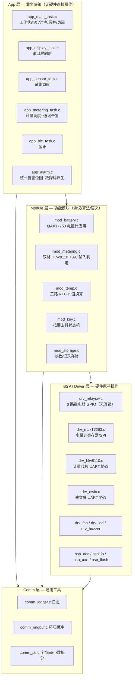
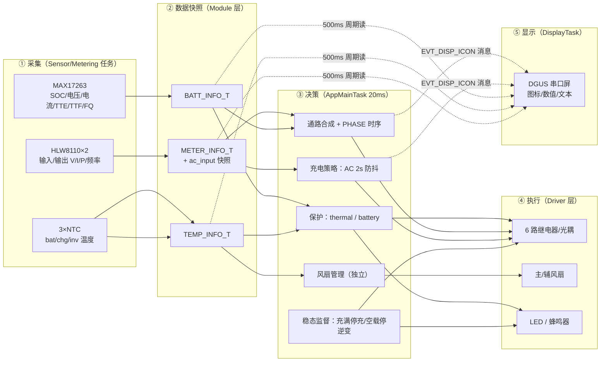
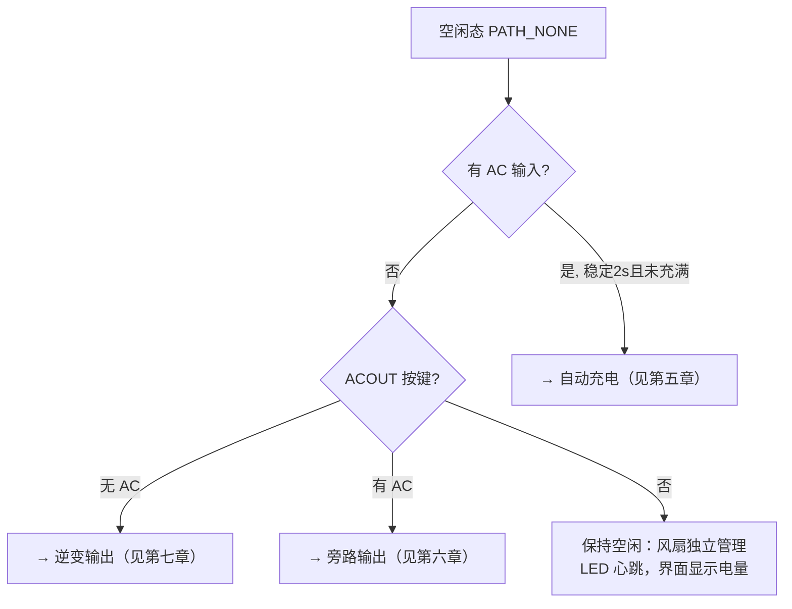
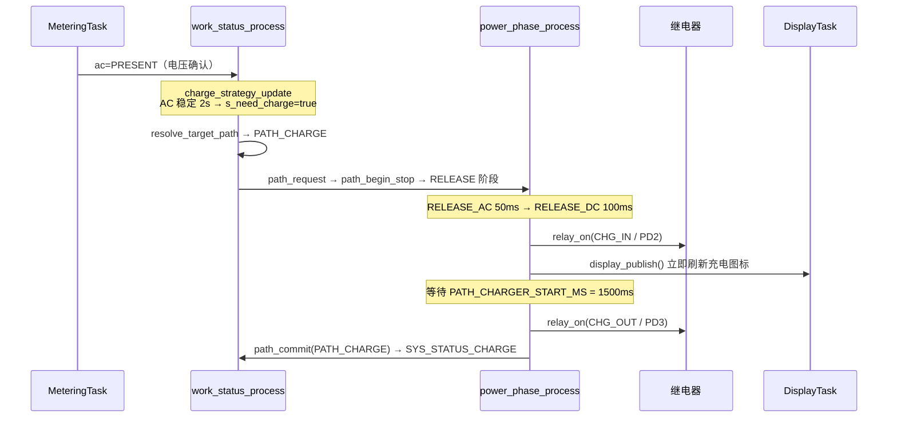
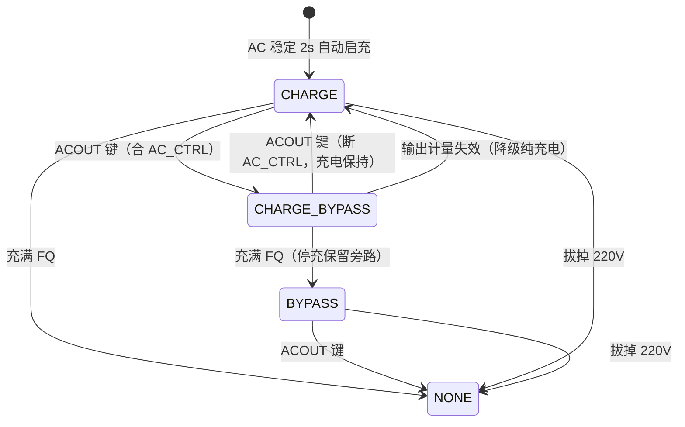
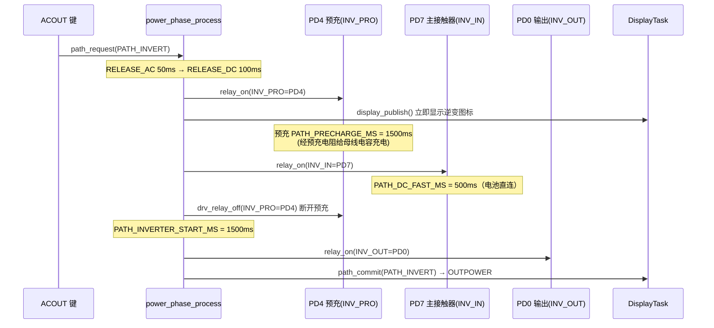
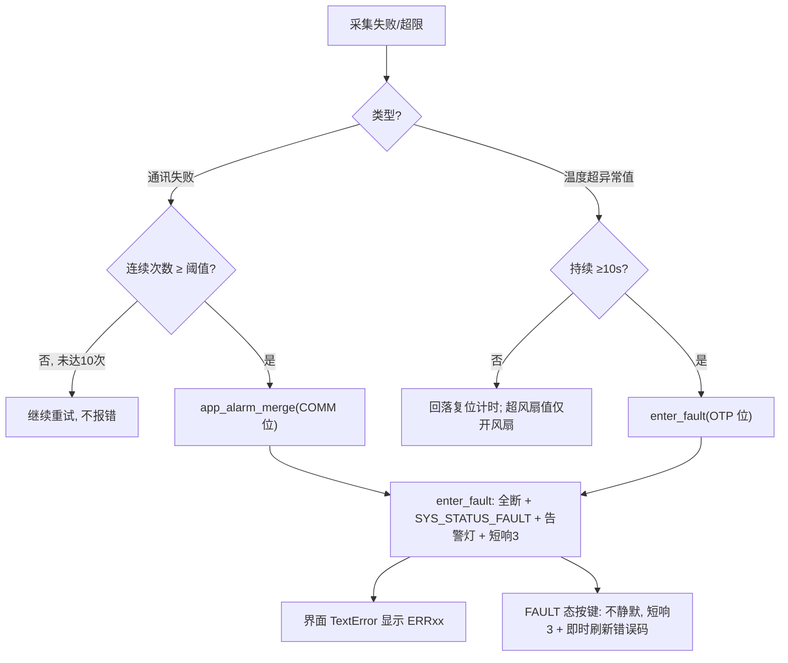
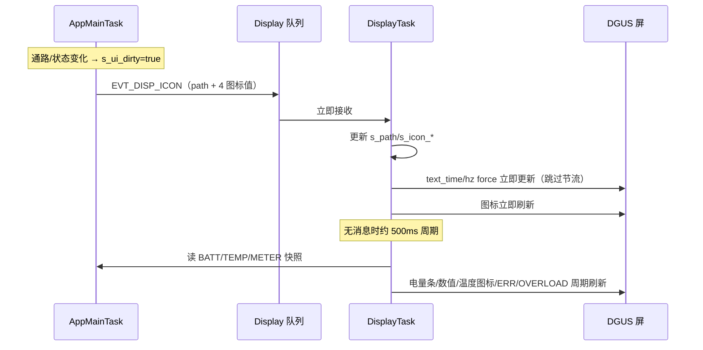
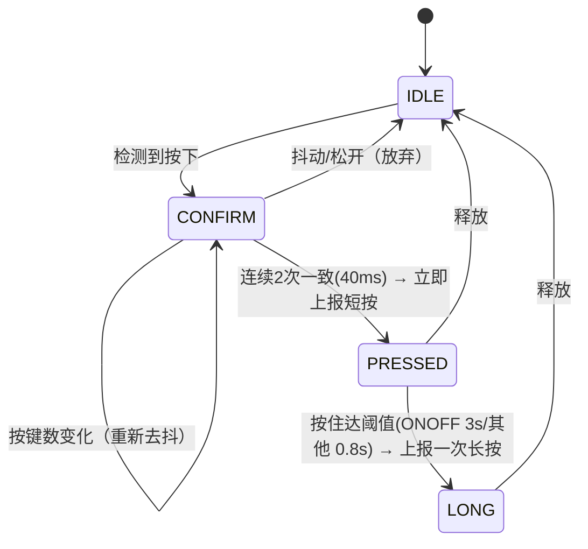

# SmartBattBox 软件架构与数据控制流评审报告


| 项目    | 内容                                                             |
| ----- | -------------------------------------------------------------- |
| 产品    | 移动储电逆变电源（SmartPowerBox / SmartBattBox）                         |
| 硬件主控  | STM32F407VG（Cortex-M4F，168MHz）+ FreeRTOS（CMSIS-RTOS v2）        |
| 代码根目录 | `D:\Project_src_code\SmartPowerBoxProject\3.code\SmartBattBox` |
| 分层模型  | BSP/Driver → Module → Comm → App                               |
| 评审日期  | 2026-10-11                                                     |
| 固件基线  | text=63928 / data=116 / bss=37172（0 error / 0 warning）         |
| 评审性质  | **只评审、不改代码**；问题分级 + 优化方案待确认后执行                                 |


***

## 一、评审结论（先看这里）

**总体评价：架构主干清晰、分层基本到位、业务可运行。** 经过多轮重构，薄封装（mod\_hmi /mod\_acswitch/bsp\_boardio）已清理，继电器互锁已从驱动层上移到 App 层，异常体系已收敛为 "通讯 ERROR + 温度 ALARM" 两类。当前**不存在阻断性逻辑错误**。

但仍有 **6 处值得收敛的问题**（详见第九章），按影响排序：


| 级别     | 编号  | 问题                                                                                            | 影响                      |
| ------ | --- | --------------------------------------------------------------------------------------------- | ----------------------- |
| **P0** | I-1 | 关机流程两套并存：按键回调内阻塞 `osDelay(800ms)` 且 `DEV_POWER_OFF()` 被调用 2 次                                 | 按键回调卡住主循环 0.8s；逻辑冗余     |
| **P0** | I-2 | `charge_strategy_update()` 末尾重复执行一次 `resolve + path_request`，与 `work_status_process()` 后续逻辑重复 | 同一 tick 重复计算 / 请求（虽被短路） |
| **P1** | I-3 | 输出计量有效性判定分散在 3 处（`m->online` / `out_ok` 守卫 /reset）                                            | 理解成本高，易漏改               |
| **P1** | I-4 | `low_soc` 阈值两处定义不一致（`battery_config.h=10` vs `project_param.c=20`）                            | 参数双源，实际生效口径需统一          |
| **P1** | I-5 | 过载（>1100W）**仅显示 OVERLOAD，无停机 / 限流动作**                                                         | 需确认是否符合安全预期             |
| **P2** | I-6 | `s_state`（系统状态）与 `path`（通路）基本一一对应，属重复表达；`thermal_protect` 内电池过温判定条件与其他方向不统一                   | 一致性维护负担                 |

> 结论：
>
> **建议执行 P0（I-1、I-2）**
>
> ，P1 视安全策略确认后执行，P2 可长期演进。本报告先评审，确认后再改代码。


***

## 二、分层架构

### 2.1 分层依赖关系




### 2.2 分层职责与关键约束


| 层              | 目录                         | 职责                                   | 关键约束（当前状态）                       |
| -------------- | -------------------------- | ------------------------------------ | -------------------------------- |
| **App**        | `App/Src` `App/Inc`        | 业务状态机、通路时序、保护策略、任务调度、界面组织            | 只通过 Module/Driver 接口访问硬件，不直接写寄存器 |
| **Module**     | `Module/Src` `Module/Inc`  | 芯片应用封装、协议语义、算法换算（NTC B 值、AC 防抖、告警折叠） | 不持有业务时序；输出结构化数据                  |
| **BSP/Driver** | `BSP/Src` `BSP/Driver/Src` | GPIO/UART/SPI/ADC/Flash 原子操作、芯片寄存器读写 | **只执行，不含互锁 / 策略**（互锁已上移 App）     |
| **Comm**       | `Comm/Src`                 | 日志、环形缓冲、字符串工具                        | 与硬件无关，可被任意层调用                    |

### 2.3 任务划分（FreeRTOS）


| 任务              | 函数             | 优先级 | 栈 (字) | 周期         | 职责                                  |
| --------------- | -------------- | --- | ----- | ---------- | ----------------------------------- |
| AppSensorTask   | `SensorTask`   | 6   | 1024  | 20ms       | MAX17263 采集；每 500ms 温度 ADC；10s 诊断日志 |
| appMeteringTask | `MeteringTask` | 6   | 512   | 100ms      | 双路 HLW8110 采集；通道通讯告警 merge/unmerge  |
| appDisplayTask  | `DisplayTask`  | 6   | 640   | 消息 + 100ms | 消息驱动图标；约 500ms 周期刷新数值 / 文本          |
| userAppMainTask | `AppMainTask`  | 6   | 1024  | 20ms       | 风扇、工作状态机、按键、LED、显示发布、看门狗            |
| appBleTask      | `BleTask`      | 5   | 512   | —          | 蓝牙通讯（当前界面 BLE 图标常灭）                 |

> 4 个任务同为优先级 6，靠 
>
> `osDelay`
>
>  协作式轮转；BleTask 优先级 5。各任务均通过独立看门狗（IWDG）心跳监控存活。


***

## 三、核心数据控制流总览

系统本质是一个 \*\*"采集 → 决策 → 执行 → 显示" 的单向数据流 \*\*，决策核心只有一个（AppMainTask），避免多头控制。




**三条关键解耦原则（当前已落地）：**


1. **执行与决策分离**：Driver 只置 GPIO，互锁 / 时序在 App。

2. **图标事件驱动、数值周期驱动**：通路变化立即发消息刷新图标；功率 / 电量等连续量 500ms 周期刷新。

3. **风扇独立于状态机**：`fan_manage()` 在主循环最前，故障 / 关机后仍散热，不受状态机门控影响。


***

## 四、业务主线一：空闲态（PATH\_NONE）

### 4.1 定义

无 220V 输入、用户未请求输出、电池未在充电。所有继电器 / 光耦断开，风扇按温度独立运行。

### 4.2 控制流




### 4.3 空闲态行为表


| 项目  | 行为                                                      |
| --- | ------------------------------------------------------- |
| 继电器 | 全断（CHG\_IN/CHG\_OUT/AC\_CTRL/INV\_PRO/INV\_IN/INV\_OUT） |
| 风扇  | 仅当温度 ≥35℃ 开启（独立于状态）                                     |
| 显示  | 电量条静态显示 SOC（非充电）；功率数值 0；时间 / 频率图标隐藏                     |
| LED | 绿灯 1s 亮灭；蓝灯每 5s 快闪 3 次                                  |
| 保护  | 温度 / 电池保护仍运行（但无通路时电池过温不触发，仅记录）                          |


***

## 五、业务主线二：自动充电（PATH\_CHARGE）

### 5.1 触发条件（全自动，无按键）


* 输入侧 HLW8110 检测到交流电压在 `METERING_AC_MIN_V ~ METERING_AC_MAX_V` 区间

* 连续 `METERING_AC_CONFIRM_SAMPLES` 个采样确认（防抖）

* 且该状态**持续稳定 ≥ AC\_STABLE\_MS（2s）**

* 且电池未充满（`full_qualified == false`）、快照有效

### 5.2 充电启动时序




### 5.3 充电稳态监督


| 监督项    | 判定                                        | 动作                                                                                  |
| ------ | ----------------------------------------- | ----------------------------------------------------------------------------------- |
| 充满自停   | MAX17263 `FStat.FQ` 上升沿（`full_qualified`） | `full_charge_auto_stop()`：PATH\_CHARGE→PATH\_NONE；CHARGE\_BYPASS→PATH\_BYPASS（保留输出） |
| 充电掉 AC | `path_needs_ac` 且 ac≠PRESENT              | `input_abort()`：全断 + 短响 2，等下次接入                                                     |
| 充电过温   | chg/bat 温度超异常阈值持续 10s                     | `enter_fault(CHG_OTP/BAT_OTP)`                                                      |
| 电池数据异常 | 快照无效 / 方向故障位                              | 启动中立即跳闸；稳态延时 2s 跳闸                                                                  |
| 输入计量失效 | 输入通道连续 10 次无数据（`in_ok=0`）                 | 置 ERROR 02；AC 掉电守卫收敛停机                                                              |

### 5.4 充满判定依据（MAX17263）


* **不是**简单比较 SOC==100，而是读取芯片 **FStat 寄存器的 FQ（Full Qualified）位**

* 充电终止由 MAX17263 充电管理逻辑 + 电池充电曲线自动判定

* 代码做 FQ **上升沿检测**（`s_full_seen`），充满只触发一次；FQ 清零（转放电）后允许再次触发


***

## 六、业务主线三：旁路输出（PATH\_BYPASS / PATH\_CHARGE\_BYPASS）

### 6.1 定义

有 220V 输入时，**市电不经过逆变器，直接通过 AC\_CTRL 继电器直通输出**（UPS 旁路），效率最高。两种组合：


| 通路                   | 含义                     | 继电器组合                                    |
| -------------------- | ---------------------- | ---------------------------------------- |
| PATH\_BYPASS         | 纯旁路输出，不充电（电池已充满 / 不需充） | AC\_CTRL(PD1)                            |
| PATH\_CHARGE\_BYPASS | 旁路输出 **+** 同时给电池充电     | CHG\_IN(PD2)+CHG\_OUT(PD3)+AC\_CTRL(PD1) |

### 6.2 旁路与充电的组合切换（不重启回路）

稳定充电态下，旁路的加入 / 退出通过 `path_request_charge_switch()` **直接合 / 分 AC\_CTRL，不重启充电回路**：




### 6.3 旁路稳态监督


| 监督项    | 判定                 | 动作                                   |
| ------ | ------------------ | ------------------------------------ |
| 掉 AC   | ac≠PRESENT         | `input_abort()`，旁路立即停止               |
| 输出计量失效 | 输出通道 `out_ok=0` 持续 | **降级为纯充电 PATH\_CHARGE**（不关闭充电，用户硬约束） |
| 逆变侧过温  | inv 温度超异常阈值 10s    | `enter_fault(INV_OTP)`               |
| 过载     | vout\_p\_w > 1100W | 当前**仅显示 OVERLOAD**（见 I-5，需确认是否停机）    |

> 进入旁路时 
>
> `path_commit`
>
>  调用 
>
> `mod_metering_reset_out_no_data()`
>
> ，输出计量从输出建立时刻重新累计，避免输出端 HLW8110 空闲期假失效。


***

## 七、业务主线四：逆变输出（PATH\_INVERT）

### 7.1 触发条件


* 用户按 ACOUT 键

* **无 220V 输入**（ac=ABSENT）→ 使用电池经逆变器输出

* 与旁路**互斥**：有 AC 走旁路，无 AC 走逆变，由 `resolve_target_path()` 统一合成

### 7.2 逆变启动三段时序（核心，严格按需求文档）




**时序要点：**


1. PD4（预充继电器 RE5）先合，经预充电阻限流给逆变器母线电容充电 **1.5s**—— 防止直接合主接触器的大电流冲击

2. PD7（外部直流主接触器）吸合，电池直连，保持 **0.5s**

3. PD4 断开（预充完成，电池直连逆变器输入）

4. 再稳定 **1.5s** 后合 PD0（逆变器输出继电器），对外输出

5. 每一步进入时 `display_publish()` 立即刷新对应图标，不等通路 commit

### 7.3 互锁规则（App 层 `relay_interlock_ok`）


| 请求动作                            | 必须满足               | 目的                     |
| ------------------------------- | ------------------ | ---------------------- |
| 合市电侧（AC\_CTRL/CHG\_IN/CHG\_OUT） | 逆变侧（PD0/PD4/PD7）全断 | 市电 / 逆变互斥              |
| 合逆变侧（PD0/PD4/PD7）               | 市电侧全断              | 市电 / 逆变互斥              |
| 合 PD7（INV\_IN）                  | PD4（INV\_PRO）已吸合   | 保证先预充                  |
| 合 PD0（INV\_OUT）                 | PD7（INV\_IN）保持     | 母线已建立（PD4 已按时序断开，不再要求） |

### 7.4 逆变稳态监督（`inverter_idle_watchdog`）


| 监督项       | 判定                                     | 动作                     |
| --------- | -------------------------------------- | ---------------------- |
| 空载自停      | `vout_p_w < INV_IDLE_PWR_W(1W)` 连续 60s | 自动停输出，清请求，短响 2         |
| 输出计量离线    | `m->online==0`（双通道合并）                  | 立即停输出                  |
| 输出通道失效    | `out_ok=0`（out\_ok 守卫）                 | 停逆变，短响 2               |
| 逆变过温      | inv 温度超异常阈值持续 10s                      | `enter_fault(INV_OTP)` |
| 电池欠压 / 过流 | UVP/OCP 故障位                            | 启动中立即 / 稳态延时跳闸         |

> **关断后不自动重启**
>
> ：清除 
>
> `s_output_requested`
>
> ，等待下次 ACOUT 按键触发，避免反复启停。


***

## 八、支撑子系统

### 8.1 异常处理体系

#### 8.1.1 异常分类与码表


| 类型        | 码        | sys\_alarm 位       | 触发条件                              | 是否停机         |
| --------- | -------- | ------------------ | --------------------------------- | ------------ |
| **ERROR** | ERR01    | BAT\_COMM(bit11)   | MAX17263 连续 ≥10 次轮询失败（3s 周期 ≈30s） | enter\_fault |
| **ERROR** | ERR02    | METER\_COMM(bit12) | HLW8110 任一通道连续 10 次无数据            | 按通道语义停机 / 降级 |
| **ALARM** | （统一码 08） | BAT\_OTP(bit2)     | 电池温度 ≥55℃ 持续 10s                  | enter\_fault |
| **ALARM** | （统一码 09） | INV\_OTP(bit4)     | 逆变温度 ≥75℃ 持续 10s                  | enter\_fault |
| **ALARM** | （统一码 10） | CHG\_OTP(bit5)     | 充电温度 ≥75℃ 持续 10s                  | enter\_fault |
| **ALARM** | （统一码 11） | LOW\_SOC(bit10)    | SOC < low\_soc（滞回 +2%）            | 提示，不停机       |

> **统一码规则**
>
> ：ERROR 类保持 01–02；无 ERROR 时 ALARM 类偏移 
>
> **+7**
>
>  → 08–11。界面 TextError 显示 
>
> `ERRxx`
>
> 。

#### 8.1.2 异常处理流程




#### 8.1.3 保护辅助位（不显示故障码）

OVP / UVP / BAT\_OCP / AC\_INPUT / BAT\_INVALID / STORAGE—— 用于内部保护逻辑判定，不直接映射界面码。继电器互锁因基于命令位、非硬件反馈，**不纳入 ERROR**（软件判断不了继电器真实触点）。

### 8.2 风扇管理（独立函数 `fan_manage`）


| 风扇            | 开启条件              | 关闭条件           | 服务对象      |
| ------------- | ----------------- | -------------- | --------- |
| 主风扇 FAN\_MAIN | bat 或 chg 温度 ≥35℃ | bat、chg 均 ≤30℃ | 电池 + 充电回路 |
| 辅风扇 FAN\_AUX  | inv 温度 ≥35℃       | inv ≤30℃       | 逆变器（含旁路）  |


* **滞回设计**：ON 35℃ / OFF 30℃，防止临界点频繁启停

* **独立于状态机**：主循环最前调用，故障态 / 关机后仍继续散热

* 温度无效（NULL）保持现状，不误动作

* **阈值关系**：风扇 35℃ < 电池异常 55℃ < 充电 / 逆变异常 75℃—— 超风扇值只开风扇，不跳闸

### 8.3 显示数据流




**显示项刷新机制分类：**


| 类别   | 控件                               | 机制                              | 节流    |
| ---- | -------------------------------- | ------------------------------- | ----- |
| 图标   | Chg/Output/HZ/UPS                | **事件驱动**（EVT\_DISP\_ICON），变化立即刷 | —     |
| 电量条  | 静态 VarIconBattPer / 动画 Animation | 充电→动画 + 静态失能；其他→静态 SOC/10 格     | 500ms |
| 数值   | SOC / 输入功率 / 输出功率                | 周期刷新                            | 500ms |
| 文本   | TextTime（剩余时间）                   | 事件 force + 3s 周期，分钟值变化才写        | 3s    |
| 文本   | TextHZ（频率）                       | 事件 force + 1s 周期，值变化才写；0Hz 写 0  | 1s    |
| 文本   | TextError（ERRxx）                 | 周期读统一码                          | 500ms |
| 文本   | TextAlarm（OVERLOAD）              | 周期读过载状态                         | 500ms |
| 温度图标 | VarIconTemp                      | 任一温度 ≥35℃ 或 OTP 位 → 显示 8        | 500ms |
| 时间图标 | VarIconTime                      | 仅充电 / 逆变时显示 13                  | 500ms |

> **文本残留处理**
>
> ：
>
> `drv_dwin_set_text`
>
>  按 max (上次长度，本次长度) 补空格；开机 
>
> `display_init_clear_text`
>
>  按控件长度空格清空，根治旧文本残留（如 123MIN→12MINN）。

### 8.4 按键数据流

#### 8.4.1 按键扫描状态机（mod\_key，20ms 轮询）




#### 8.4.2 按键功能定义（当前仅 2 个有效动作）


| 按键    | 有效事件        | 动作                                                 |
| ----- | ----------- | -------------------------------------------------- |
| ONOFF | 长按 3s       | 关机：安全断电 + 熄灭 MAX17263 LED + 数据保存 + DEV\_POWER\_OFF |
| ACOUT | 短按          | toggle 输出：有 AC→旁路；无 AC→逆变；再按关闭                     |
| ACIN  | （应用层屏蔽，不响应） | 充电改为接入 220V 自动触发，ACIN 不再作为启动开关                     |
| K1    | （未使用）       | —                                                  |

#### 8.4.3 蜂鸣反馈语义


| 场景                           | 短响次数 |
| ---------------------------- | ---- |
| 通路请求成功 / 充满停充                | 1    |
| 通路请求被拒 / AC 未知 / 空载自停 / 掉 AC | 2    |
| FAULT 态按键 /enter\_fault      | 3    |


***

## 九、架构问题清单与优化方案

### P0 — 建议立即执行

#### I-1 关机流程两套并存、回调内阻塞

**现状（**`handle_onoff_key`**，:697-717）：**


```
s_shutting_down = true;
drv_relay_all_off();
path_begin_stop(PATH_NONE);
mod_battery_led_mask(0);
drv_buzzer_short_sound(1);
osDelay(300);
DEV_POWER_OFF();   /* 第 1 次断电 */
osDelay(500);
/* 之后 shutdown_process() 在 RELEASE_DC 阶段又会: */
/*   mod_battery_checkpoint(); DEV_POWER_OFF();  ← 第 2 次断电 */
```

**问题：**


1. 按键回调在 `mod_key_poll_handler()` 内**同步执行**，`osDelay(300)+osDelay(500)` 会卡住主循环 0.8s，期间保护 / 显示 / 喂狗停滞

2. `DEV_POWER_OFF()` 调用 2 次（虽幂等，但语义混乱）

3. "立即断电" 与 "状态机延时断电" 两套路径并存

**优化方案（待确认）：**


* 回调内**只做**：置 `s_shutting_down=true`、`drv_relay_all_off()`、`led_mask(0)`、短响 1，**移除 osDelay 与 DEV\_POWER\_OFF**

* 断电动作统一收敛到 `shutdown_process()` 的 RELEASE\_DC 阶段（checkpoint 后 DEV\_POWER\_OFF 唯一一次）

* 若担心状态机断电太慢，可把 RELEASE 阶段延时在关机场景缩短为 0 / 极小值，而非在回调阻塞

#### I-2 充电策略内重复 resolve + request

**现状：** `charge_strategy_update()` 末尾（:831-835）：


```
energy_path_t target = resolve_target_path(ac, s_output_requested, s_need_charge);
if (target != s_target_path) path_request(target, ac);
```

而 `work_status_process()` 在 :1143-1147 又执行**完全相同**的 resolve + request。

**优化方案：**


* `charge_strategy_update()` **只负责**更新 `s_need_charge`（含防抖），删除末尾 resolve/request

* 通路合成与请求统一由 `work_status_process()` 单点执行

* 职责更纯：策略归策略、切换归切换

### P1 — 确认后执行

#### I-3 输出计量判定分散 3 处

**现状：**


* `inverter_idle_watchdog()` 用合并的 `m->online`（双通道，输入正常时输出失效不体现）

* `work_status_process()` 独立 `out_ok` 守卫（:1161）

* `path_commit` 调 reset 重置计数

**优化方案：**


* 逆变 / 旁路稳态判定统一改用**分通道&#x20;**`out_ok`，不再依赖合并 `online`

* 将 "输出失效→停逆变 / 旁路降级" 收敛为一个 `output_channel_guard()` 函数

* `inverter_idle_watchdog()` 只保留 "空载 60s 自停" 单一职责

#### I-4 low\_soc 参数双源不一致

**现状：**


* `Module/Inc/battery_config.h:20` → `.low_soc=10`

* `App/Src/project_param.c:24` → `.low_soc=20`

**优化方案：** 确认唯一口径（建议以 battery\_config.h 静态配置为准 =10），删除 / 注释 project\_param.c 中冗余项，统一参数来源。

#### I-5 过载仅显示、无保护动作

**现状：** vout\_p\_w > 1100W（额定 1000W×1.1）仅界面显示 OVERLOAD，**不停机、不限流**。

**需用户确认（安全决策，不擅自改）：**


* 方案 A：维持现状（仅报警，由外部断路器 / 逆变器自保护）

* 方案 B：过载持续 N 秒后 enter\_fault 停机

* 方案 C：立即停机

> 此项涉及安全策略，报告只列出，待裁决。

### P2 — 长期演进（可选）

#### I-6 状态变量重复表达


* `s_state`（SYS\_STATUS\_*）与&#x20;*`path`*（PATH\_*）在稳态基本一一对应（CHARGE↔CHARGE、OUTPOWER↔INVERT…），仅 SWITCHING 对应多 PHASE

* `thermal_protect()` 中电池过温用 `s_target_path != PATH_NONE`，而 chg/inv 用 `charge/invert` 参数，条件不统一

**优化方向（改动面较大，建议谨慎）：**


* 文档化 state↔path↔phase 映射关系；或将 `s_state` 改为由 path+phase **派生**（`state_derive()`），消除一致性维护

* 统一 thermal\_protect 三个方向的判定条件（统一用 active 标志）


***

## 十、不做事项 / 待确认


| 项                         | 说明                                        |
| ------------------------- | ----------------------------------------- |
| 不按业务域拆分 app\_main\_task.c | 用户已明确 "不要划分文件"，保持单文件，通过函数内聚组织             |
| 继电器状态不纳入故障码               | 无硬件反馈输入，软件只能读命令位，无法判定真实触点                 |
| TTE/TTF 当前仅采集、不强制显示格式     | 芯片寄存器（5.625s 分辨率）；有效性依赖电流方向 + 寄存器非 0xFFFF |
| BLE 图标常灭                  | 当前界面不显示，功能保留                              |
| BATTERY\_CSV\_ENABLE      | 用户曾要求去掉、后改 "先留着"，当前保留不启用                  |

### 待用户确认清单


1. **P0（I-1、I-2）是否执行？**（建议执行）

2. **I-3、I-4 是否执行？I-4 低电量阈值取 10 还是 20？**

3. **I-5 过载保护策略选 A/B/C？**

4. **P2（I-6）是否纳入本轮，还是长期演进？**


***

## 附录：关键时序与阈值参数汇总


| 宏                            | 值             | 含义               | 定义位置              |
| ---------------------------- | ------------- | ---------------- | ----------------- |
| PATH\_RELEASE\_MS            | 50ms          | 交流侧释放等待          | app\_main\_task.c |
| PATH\_CONTACTOR\_RELEASE\_MS | 100ms         | 直流接触器释放等待        | app\_main\_task.c |
| PATH\_CHARGER\_START\_MS     | 1500ms        | CHG\_IN 后充电器稳定时间 | app\_main\_task.c |
| PATH\_PRECHARGE\_MS          | 1500ms        | 逆变 PD4 预充时间      | app\_main\_task.c |
| PATH\_DC\_FAST\_MS           | 500ms         | PD7 后直连稳定、断 PD4  | app\_main\_task.c |
| PATH\_INVERTER\_START\_MS    | 1500ms        | 直连后到 PD0 输出时间    | app\_main\_task.c |
| PATH\_STOP\_CHARGE\_TAIL\_MS | 1500ms        | 停充尾段延时           | app\_main\_task.c |
| PATH\_STOP\_INV\_TAIL\_MS    | 1500ms        | 停逆变尾段延时          | app\_main\_task.c |
| PATH\_INPUT\_WAIT\_MS        | 5000ms        | AC 未知等待上限        | app\_main\_task.c |
| AC\_STABLE\_MS               | 2000ms        | 自动充电 AC 防抖       | app\_main\_task.c |
| INV\_IDLE\_STOP\_MS          | 60000ms       | 逆变空载自停           | app\_main\_task.c |
| INV\_IDLE\_PWR\_W            | 1W            | 空载判定阈值           | app\_main\_task.c |
| BATTERY\_ACTION\_DELAY\_MS   | 2000ms        | 稳态电池异常跳闸延时       | battery\_config.h |
| THERMAL\_FAULT\_DELAY\_MS    | 10000ms       | 过温持续跳闸延时         | app\_main\_task.c |
| BAT\_COMM\_ERR\_THRESHOLD    | 10 次          | MAX17263 通讯失败阈值  | mod\_battery.c    |
| METERING\_NO\_DATA\_TIMEOUT  | 10 次          | HLW8110 无数据阈值    | mod\_metering.c   |
| FAN ON / OFF                 | 35℃ / 30℃     | 风扇滞回             | Board.h           |
| BAT 温度 WARN / FAULT          | 45℃ / 55℃     | 电池温度阈值           | Board.h           |
| CHG/INV 温度 WARN / FAULT      | 60℃ / 75℃     | 充电 / 逆变温度阈值      | Board.h           |
| 额定 / 过载功率                    | 1000W / 1100W | 输出功率阈值           | Board.h           |