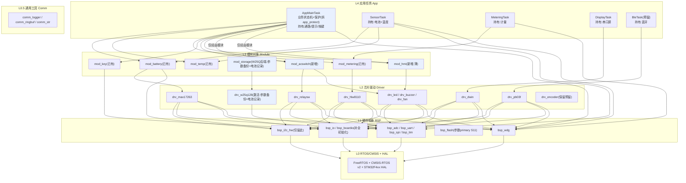

# SmartBattBox 代码框架重构方案评审（v1）

> 评审对象：
>
> `D:\Project_src_code\SmartPowerBoxProject\3.code\SmartBattBox`
> 平台：STM32F407VGT6 + FreeRTOS + CMSIS-RTOS v2 + STM32F4xx HAL
> 原则：
>
> **按需确认后的决策均已锁定**
>
> ；本方案只做规划，不修改代码。
> 依赖规则（贯穿全文）：
>
> **上层只调用下层；每个硬件外设由唯一任务持有，其他任务只能读快照 / 提交请求；App 不直连 Driver/BSP。**

***

## 一、决策确认表（用户已锁定）

| 类别     | 条目                             | 决策                                       | 落点                             |
| ------ | ------------------------------ | ---------------------------------------- | ------------------------------ |
| A 死代码  | drv\_encoder                   | **保留（预留）**                               | 不删除                            |
| A 死代码  | BLE 设备                         | **保留（预留）**                               | 保留 BleTask 与 JSON 上报接口         |
| A 死代码  | xMainQueueHandle               | **保留，AppMainTask 改为读消息，10→6 槽**          | freertos.c + app\_main\_task.c |
| A 死代码  | app\_exti\_callback            | **去掉**                                   | app\_sensor\_task.c            |
| A 死代码  | mod\_storage\_log\_append      | **去掉**                                   | mod\_storage.{c,h}             |
| B 重复   | 模拟 I2C（bsp\_i2c.c）             | **去掉**                                   | 仅留 bsp\_i2c\_hw                |
| B 重复   | Flash 存储布局                     | **参数 primary 用 MCU 最后一个扇区（S11）；参数备份写外部 Flash；电池学习参数恢复到外部 Flash 存储** | project\_param + mod\_storage + drv\_w25q128 |
| B 重复   | 同地址宏双定义                        | **保留 project\_param.h**                  | 移除 bsp\_flash.h 的重复定义          |
| B 重复   | 双日志 API                        | **log\_print 直打 / logger\_out 受控，职责分离；`logger_print` 改名 `logger_out`** | comm\_logger 明确契约              |
| B 重复   | 两套告警位图                         | **都去掉，统一一套**                             | 新增统一告警模型                       |
| B 重复   | 初始化入口分散                        | **整理统一**                                 | 收敛到单一 init 序列                  |
| B 重复   | main.h 重复 include              | **处理**                                   | app\_display\_task.c           |
| C 仓库冗余 | Debug/Release/ 旧工程 / AI 痕迹     | **整理**                                   | .gitignore + 归档                |
| 三 过度设计 | 任务级消息队列                        | **保留**                                   | 且使 AppMainTask 真正消费消息          |
| 三 过度设计 | battery\_app\_\* 公共 API        | **按方案调整**                                | 收敛为 mod\_battery.c 私有          |
| 三 过度设计 | JSON 状态上报                      | **按方案调整**                                | 保留并由 BleTask 消息触发调用            |
| 三 过度设计 | battery\_store\_t 双扇区 / CRC 抽象 | **保持原契约（外部 4KB 扇区）**                      | 无需改造                            |

***

## 二、目标分层架构（调整后）

**分层判定**：

* 删除的名存实亡层：无（L4 Service 在现状已移除，本方案不恢复，改为 "模块对象 + 单任务持有" 范式，避免重新引入空 Service 层）。

* 补齐的缺口：`mod_acswitch`（能量通路对象）、`mod_hmi`（提示 / 指示薄对象）—— 把 App 直连的继电器 / 风扇 / LED / 蜂鸣器收归模块。

* 调整的层：`bsp_flash` 收敛为**参数 primary（S11）单一用途**，轻泛化（由调用方传入 base/size/sector）；外部 Flash（W25Q128）恢复为**参数备份 + 电池学习记录**承载，`drv_w25q128` 重新激活。

> 存储归属说明：`project_param`（App）参数 primary 走内部 `bsp_flash`（BSP），参数备份经 `mod_storage`（Module）走 `drv_w25q128`（Driver）；电池学习记录由 `mod_storage` → `drv_w25q128`。App 不直连外部 Flash 驱动。

***

## 三、A 类：死代码处理方案

| 项                         | 处理   | 详细方案                                                                                                   |
| ------------------------- | ---- | ------------------------------------------------------------------------------------------------------ |
| drv\_encoder              | 保留   | 不删除，作为后续旋钮 / 菜单预留。**退出构建**（从 sources.mk/ 构建源列表移除），避免无效 RAM/ROM 占用；需要时再入构建。                             |
| BLE 预留                    | 保留   | BleTask 保持。见 "三 - 过度设计 - JSON"，把 `app_ble_report_status()` 接线到 BleTask 消息触发。                           |
| xMainQueueHandle          | 改造启用 | 见 "五 - 消息路由"。槽数 10→6（`MAIN_MSG_QUEUE_MAX_NUM 6`），并让 AppMainTask 主循环 `xQueueReceive(xMainQueueHandle)`。 |
| app\_exti\_callback       | 删除   | 移除 `app_sensor_task.c` 的空壳函数与 `stm32f4xx_it.c` 中的调用点（若存在）。EXTI 未来需要时再实现。                               |
| mod\_storage\_log\_append | 删除   | 从 `mod_storage.{c,h}` 删除该桩函数及其声明。                                                                      |

> 备注：Sensor/Metering/Ble 三个任务自身的队列（`xSensor/Metering/BleQueueHandle`）用户未列删除项，默认**保留**（预留消息能力），但明确它们当前可为空处理，不视为必须清空。

***

## 四、B 类：功能重复处理方案

### 4.1 去掉模拟 I2C

* 删除 `BSP/Src/bsp_i2c.c`、`BSP/Inc/bsp_i2c.h`，仅保留 `bsp_i2c_hw.{c,h}`。

* 核查：全工程 `bsp_i2c_*` 无实际调用方（仅 bsp\_i2c\_hw 注释提及），删除无回归风险。

* 若未来需要第二条 I2C，建议以 `bsp_i2c_hw` 为模板扩展为 "外设句柄数组"，而非重写软件模拟。

### 4.2 Flash 存储方案（修订：参数 internal + 备份/电池记录 external）

**决策（用户锁定）**：参数 primary 用 MCU 最后一个扇区（S11）；参数备份写到外部 Flash；电池学习参数恢复到外部 Flash 存储。

**内部 Flash 分区（MCU，1MB，S0–S11）**：

| 用途 | 扇区 | 基址 | 大小 | 归属层 | 常量宿主 |
|---|---|---|---|---|---|
| 参数 primary | S11 | 0x080E0000 | 128KB | App（project\_param） | `project_param.h`（保留） |
| 固件代码 / 常量 | S0–S10 | 0x08000000–0x080BFFFF | ≤768KB | 固件 | — |

**外部 Flash 分区（W25Q128，SPI2，每扇区 4KB）**：

| 用途 | 扇区 | 大小 | 归属层 | 常量宿主 |
|---|---|---|---|---|
| 参数 backup | 扇区 0（`STORAGE_SEC_CONFIG`） | 4KB | App（project\_param）经 mod\_storage | `mod_storage.h` |
| 电池学习记录 | 扇区 9/10（`STORAGE_SEC_BATTERY_START=9, COUNT=2`） | 2×4KB | Module（mod\_storage） | `mod_storage.h`（已有） |
| 日志区 | 扇区 1–8 | 32KB | 闲置（log\_append 已删） | — |

**扇区布局权威来源**：STM32F407 的 Flash 扇区划分（4×16KB + 1×64KB + 7×128KB）定义在 ST 参考手册 RM0090 第 3 章 Flash、表 5 Flash module organization (STM32F40x and STM32F41x)（官方 https://www.st.com/resource/en/reference_manual/dm00031020.pdf ；国内镜像 https://www.stmcu.com.cn/upload/pdf_html/2a4a9956e6bc3957a4ae5cb0611d7d6b.html ），数据手册 DS8626 Section 4 Memory map 佐证；HAL 侧由 stm32f4xx_hal_flash_ex.h 的 FLASH_SECTOR_0…11 枚举体现。本项目现状 bsp_flash.h（S11 @ 0x080E0000）与此一致。

**battery\_store\_t 契约：保持原样，无需改造**：

* 电池学习记录回到外部 W25Q128（4KB 扇区），`battery_store_t` 的 `sector_size=4096` + 双扇区轮换 + `scan 2×sector_size` 契约**完全成立**，`mod_battery_init()` 中 store 绑定与现有实现一致，无需任何改动。

* 因此，此前 "改用内部 MCU Flash" 的**单扇区 / 擦除粒度改造整段撤销**（内部 Flash 擦除粒度 16/64/128KB 与 4KB 契约冲突的问题不复存在）。

**记录格式与大小**（已核实源码，保持不变）：

* 芯片侧原始学习参数 `max17263_learned_t` = 5×uint16 = **10 字节**（rcomp0 / tempco / fullcaprep / fullcapnom / cycles）。
* **落盘记录为固定 64 字节**（`BATTERY_RECORD_SIZE=64`）：

| 偏移 | 字段 | 大小 |
|---|---|---|
| 0 | magic | 4 |
| 4 | version | 4 |
| 8 | seq（递增序号） | 4 |
| 12 | profile hash | 4 |
| 16 | battery\_id | 4 |
| 20–39 | 5 项学习值（各占 32 位槽） | 20 |
| 56 | CRC32 | 4 |
| 60 | commit 标记 | 4 |

**参数 primary / backup 读写**：

* `param_store()`：primary 写内部 S11（`bsp_flash`）+ **backup 写外部 W25Q 扇区 0**（经 `mod_storage` 新增接口），双写后回读校验。
* `param_init()`：先读内部 primary，校验失败再读外部 backup 回退。
* 依赖方向：`project_param`（App）→ `bsp_flash`（BSP，primary）+ `mod_storage`（Module，backup）→ `drv_w25q128`（Driver），App 不直连外部 Flash 驱动。

**落地改动点**：

* `project_param.c/h`：参数备份路径改为经 `mod_storage` 写外部 Flash；`param_store` 双写 primary+backup；`param_init` 增加 backup 回退读取。
* `mod_storage.c/h`：**保持 W25Q 后端**；新增 `mod_storage_param_backup_read/write`（扇区 0）；删 `mod_storage_log_append`。
* `mod_battery.c`：`store.sector_size` **保持 4096**，绑定不变（无需改动存储契约）。
* `bsp_flash.c/h`：保持参数 primary（S11）用途；仅删重复常量（见 4.3）。
* `drv_w25q128.{c,h}`：**恢复激活**（重新入构建），承担参数备份 + 电池学习记录。

### 4.3 同地址宏双定义

* **保留 `project_param.h` 的 `PARAM_FLASH_BASE`（0x080E0000）** 为参数 primary 唯一事实来源。

* 删除 `bsp_flash.h` 中的 `BSP_FLASH_PARAM_BASE/SIZE/SECTOR` 重复定义。

* `bsp_flash` 轻泛化：`bsp_flash_init(base,size,sector)` 由调用方（project\_param）传入，`read/write/erase` 以 base 为基准——`bsp_flash.c` 不再硬编码常量，依赖方向保持 App→BSP，不出现 BSP→App 反向引用。

* `mod_storage.h` 持有外部 Flash 分区常量（参数备份扇区 0、电池扇区 9/10，沿用已有 `STORAGE_SEC_*`）。

### 4.4 双日志 API 职责分离

在 `comm_logger.h` 明确定义契约并全工程统一使用：

| API                            | 语义                                    | 适用场景             |
| ------------------------------ | ------------------------------------- | ---------------- |
| `log_print(fmt,...)`           | 无级别直打（= `logger_out(LOG_NONE,...)`） | ISR / 裸输出 / 瞬时诊断 |
| `logger_out(level, fmt,...)`   | 带级别、受控过滤（`logger_print` 改名而来）       | 所有任务级日志，一律带级别    |
| `log_info/warn/error/debug`    | 便捷宏，带级别                               | 常规业务日志（推荐主用）     |

* 整改：`app_metering_task.c` 中 `metering_verify_syscon()` 混用的 `log_print` 改为 `log_info`；其余统一为带级别入口。`log_print` 仅留给真正需要裸输出的少数路径。

### 4.5 两套告警位图统一（都去掉 → 一套）

* **目标**：全系统只保留一套告警位图 `sys_alarm_t`（位义单一、跨层传递一致）。

* 落点：新建共享头 `App/Inc/sys_alarm.h`（或收敛进 `app_main_task.h`），定义系统级告警位，覆盖：电池过压 / 欠压 / 过温 / 过流、逆变过温、充电过温、AC 输入异常、继电器故障、电池数据无效、外部存储故障等。

* `mod_battery.c`：内部保留自身故障状态机，但对外**不再暴露 `BAT_FAULT_*` 位图**；提供一个 `battery_alarm_bits()` 映射函数，把电池故障折叠为 `sys_alarm_t` 中的对应位，供 AppMainTask 读取合并。

* `app_main_task.c`：删除本地 `ALM_*` 定义，改用 `sys_alarm_t`；告警合并逻辑收敛为单一函数 `alarm_merge()`。

* 收益：消除 `ALM_BAT_OVP(1<<1)` 与 `BAT_FAULT_OV(bit3)` 的位义错位；跨任务 / 跨模块报警传递唯一化。

### 4.6 初始化入口统一

* **补缺**：`bsp_boardio_init()` 当前注释声明含蜂鸣器但漏调 `drv_buzzer_init()` → 补齐。

* **去重**：`main.c:173` 的 `drv_buzzer_init()` 移除（避免二次初始化），设备初始化统一收敛到 `MX_FREERTOS_Init()` 内的单一有序序列。

* 目标 init 序列（唯一次序，全部在 `MX_FREERTOS_Init`）：

1. `bsp_boardio_init()`（relay→fan→led→buzzer，含安全断电时序）

2. `mod_storage_init()`（建锁；W25Q 探测延后到任务首次请求）

3. `drv_dwin_init(UART4)`

4. 各 `mod_*_init()` 保持在各自持有任务的入口处（SensorTask 里 `mod_battery_init/mod_temp_init`、MeteringTask 里 `mod_metering_init` 等）——**遵循 "持有者初始化" 原则**。

* 明确分工：`main.c` 只做 CubeMX 外设初始化；设备 / 模块初始化全部归任务侧或 `MX_FREERTOS_Init`，杜绝分散。

### 4.7 main.h 重复 include

* 移除 `app_display_task.c` 中重复的 `#include "main.h"`。

***

## 五、C 类：构建 / 仓库冗余整理

| 项                             | 方案                                                                                                                                  |
| ----------------------------- | ----------------------------------------------------------------------------------------------------------------------------------- |
| 新增 `.gitignore`               | 至少排除：`Debug/`、`Release/`、`*.o *.d *.elf *.bin *.map *.hex *.cyclo *.su`、`.claude/`、`docs/superpowers/`、`tools/` 缓存、`_fix_if.py` 生成物 |
| Debug/ Release 陈旧构建           | 从版本库移除（由 CI/IDE 重建）；**移除前先确认无人引用其中产物**                                                                                              |
| `Doc/8112_uart_code_rev5_001` | 整体移出版本库（归档到仓库外或独立分支），与当前 F407 项目无关联                                                                                                 |
| AI 工具痕迹                       | `.claude/plans`、`docs/superpowers` 等与产品代码隔离；`_fix_if.py` 先审计再定去留                                                                    |
| 保留                            | `.cproject/.project/.mxproject/.ioc/ld/sct`（工程元数据）、`Doc/*.pdf`（数据手册，保留）                                                             |
| 规整                            | 顶层出现 `App/BSP/Comm/Core/Module/Drivers/Middlewares` 一级业务目录，`Doc/docs/tools/tests` 二级辅助目录；整理后 `tests/` 明确测试归属                        |

***

## 六、三、过度设计处理方案

| 项                              | 决策     | 方案                                                                                                                                                                                                                                                                        |
| ------------------------------ | ------ | ------------------------------------------------------------------------------------------------------------------------------------------------------------------------------------------------------------------------------------------------------------------------- |
| 任务级消息队列                        | **保留** | 保留 `ucMESSAGE_t` + 各任务队列 + `Send_Msg_*` 框架，并使其**真正被消费**：AppMainTask 接入主队列（见 "七 - 消息路由"）。                                                                                                                                                                                  |
| `battery_app_*` 公共 API         | 收敛为私有  | 将 `app_battery.h` 中 `battery_app_start/process/clear_history/checkpoint/led_mask/led_soc` 及 `battery_store_t/battery_policy_t` 等**实现细节**移入 `mod_battery.c` 私有（或迁到 `Module/Inc/mod_battery_internal.h`），对外仅保留 `mod_battery_*` 与快照接口。命名上不再以 `app_` 前缀出现在 Module 层，消除跨层命名混淆。 |
| JSON 状态上报                      | 保留并接线  | `app_ble_report_status()` 保留；BleTask 增加对命令消息（如 `EVT_BLE_REPORT`）的处理，收到后调用上报。消除 "定义不调用" 的死代码态。                                                                                                                                                                             |
| `battery_store_t` 双扇区 / CRC 抽象 | **保持原契约** | 电池记录回到外部 4KB 扇区（W25Q），`sector_size=4096` + 双扇区轮换 + CRC/commit/readback 全部保留，**无需任何改造**。 |

***

## 七、五、上层应用解耦调整方案

### 7.1 AppMainTask 拆分

现状：808 行 "上帝任务"（占 App\Src 54%），include 19 个头文件（含 4 个 BSP 驱动）。

拆分目标：`app_main_task.c` **收敛为 "业务编排 + 通路状态机"（约 350–400 行）**，职责外移：

| 职责            | 现状                      | 去向                                                                       |
| ------------- | ----------------------- | ------------------------------------------------------------------------ |
| 保护阈值判定 / 故障合并 | 内嵌                      | 抽出 `app_protect.c`（`app_protect_check()`，输入：温度快照 + 电池快照 + 计量快照 → 输出故障动作） |
| 继电器 / 通路互锁时序  | 内嵌 drv\_relaysw         | 移入 `mod_acswitch`（`select_path/current_path`，互锁 + 先断后通在此强制）              |
| 风扇控制          | 内嵌 drv\_fan             | 移入 `mod_acswitch`（`set_fan()`），由通路 / 温度驱动                                |
| 告警 LED / 蜂鸣   | 内嵌 drv\_led/drv\_buzzer | 移入 `mod_hmi`（`alarm_on/buzz`）                                            |
| 显示推送          | 内嵌 Send\_Msg            | 保留消息推送（DisplayTask 已解耦）                                                  |
| 按键            | mod\_key 回调             | 保留，改经主队列上报（见 7.2）                                                        |
| 关机时序 / 参数初始化  | 内嵌                      | 保留在 app\_main\_task（属业务编排）                                               |

### 7.2 新增模块对象

**mod\_acswitch（能量通路对象，AppMainTask 持有执行）**：

* API：`mod_acswitch_init()`、`bool mod_acswitch_select_path(energy_path_t)`（内部强制 "先全断→死区≥50ms→吸合目标→回读校验"）、`energy_path_t mod_acswitch_current_path()`、`bool mod_acswitch_relay_on/off(id)`、`void mod_acswitch_set_fan(fan,on)`。

* 私有：drv\_relaysw + drv\_fan；互锁逻辑从 app\_main\_task 迁入，符合设计文档 "互锁在驱动内强制，应用层不可绕过"。

* 边界：仅 AppMainTask 触碰本对象；其余任务（如保护）提交请求或读状态，不直接操作继电器。

**mod\_hmi（提示 / 指示薄对象，AppMainTask 持有执行）**：

* API：`mod_hmi_alarm_on/off()`、`mod_hmi_buzz(short_times)`；聚合 drv\_led（ALM）+ drv\_buzzer。

* 电池 12 灯仍由 SensorTask 经 mod\_battery 管理，不与 mod\_hmi 冲突（不同指示域）。

* 说明：此为薄门面，若你倾向最小改动，可退化为 "AppMainTask 直调 drv\_led/drv\_buzzer（仅持有任务触碰）"，本方案以 mod\_hmi 为推荐。

### 7.3 消息路由设计（使主队列真正消费）

`xMainQueueHandle`（6 槽）作为**业务事件队列**，承载跨任务进入 AppMainTask 的事件：

| 事件                  | 来源任务                                        | 触发        |
| ------------------- | ------------------------------------------- | --------- |
| `EVT_KEY`           | AppMainTask 自身（mod\_key 回调→入队）或 mod\_key 直发 | 按键 / 长按   |
| `EVT_AC_INPUT`      | MeteringTask                                | 市电状态变化    |
| `EVT_BATTERY_FAULT` | SensorTask                                  | 电池故障 / 恢复 |
| `EVT_BLE_CMD`       | BleTask                                     | 蓝牙命令（预留）  |
| `EVT_DISP_ACK`      | DisplayTask                                 | 屏就绪 / 回执  |

* AppMainTask 主循环：`xQueueReceive(xMainQueueHandle, timeout)` 处理事件 + 周期调用 `power_process()`（保持非阻塞状态机）。

* 现有 `Send_Msg_AppDisplayTask` 保留；DisplayTask 仍由 AppMainTask 推送图标消息。

* 结果：**每个 App 任务只通过 "队列 (事件)+ 快照 (数据)" 与业务层交互，不再互相直调驱动**。

### 7.4 上层解耦达成度评估

| 判据              | 现状                           | 调整后                                              |
| --------------- | ---------------------------- | ------------------------------------------------ |
| App 是否直连 Driver | 是（4 个驱动）                     | 否（经 mod\_acswitch/mod\_hmi）                      |
| App 是否直连 BSP    | 是（bsp\_wdg/bsp\_io/bsp\_adc） | 收敛（bsp\_wdg 心跳仍允许；bsp\_io/bsp\_adc 归 SensorTask） |
| 任务间数据           | 全局快照（对）                      | 保持快照范式                                           |
| 任务间事件           | 单一消息                         | 统一走主队列                                           |
| 硬件替换代价          | 牵动 App 多处                    | 收归模块 / 持有任务                                      |

***

## 八、落地顺序与风险

### 8.1 落地顺序（建议，按风险递增）

1. **清理层（低风险，先行）**：`.gitignore`、移除 Debug/Release 陈旧构建与 8112 旧工程、删 `app_exti_callback`、删 `mod_storage_log_append`、去 main.h 重复 include。

2. **去重层（低 - 中风险）**：删模拟 I2C；日志契约统一（`logger_out`）；告警位图合并为 `sys_alarm_t`；init 入口统一（含补 `drv_buzzer_init`）。

3. **存储层（中风险，需烧录验证）**：`drv_w25q128` 重新激活；`mod_storage` 保持 W25Q 后端 + 新增参数备份接口（扇区 0）；`project_param` 参数备份改走外部 Flash（双写 + 回退读取）；`bsp_flash` 轻泛化 + 删重复常量。

4. **解耦层（中 - 高风险，分批）**：新增 `mod_acswitch`/`mod_hmi` → 拆分 `app_protect.c` → AppMainTask 接入主队列消息。

### 8.2 风险与对策

| 风险                         | 对策                                        |
| -------------------------- | ----------------------------------------- |
| 参数 primary / backup 分属内外 Flash，重启回退链复杂 | 烧录后验证 "内部 primary 损坏 → 自动读外部 backup" 全链路；保留回读校验与日志 |
| 外部 Flash 初始化时序（开机先于参数读取）          | `mod_storage` 保持懒探测（首次请求才 init W25Q）；`param_init` 在 AppMainTask 中调用，此时 W25Q 可安全访问 |
| 告警位图合并误伤既有日志 / 上位机解析               | 保留日志中原字段打印，仅内部语义统一；改动前备份当前 `.map`/ 串口格式基线 |
| 解耦拆分引入回归                     | 每拆一步单独编译 + 烧录验证（模块自测→联调→全流程）              |

### 8.3 验证方式

* 存储：单元验证电池记录 "写→读回→断电重启→加载最新记录"（外部 W25Q 双扇区轮换）；验证参数 "primary 写内部 S11 + backup 写外部扇区0 → primary 人为损坏 → 从 backup 恢复"。

* 解耦：grep 确认 App 层不再 include `drv_*`/`bsp_io` 等；编译告警清零。

* 回归：`Debug`/`Release` 各跑一轮关键路径（上电→BYPASS/CHARGE/INVERT→关机保存），日志基线比对。

***

## 附：改动文件一览（规划，未执行）

| 文件                                                                 | 动作                                       |
| ------------------------------------------------------------------ | ---------------------------------------- |
| `BSP/Src/bsp_i2c.c`、`BSP/Inc/bsp_i2c.h`                            | 删除                                       |
| `BSP/Src/bsp_i2c_hw.*`                                             | 保留                                       |
| `BSP/Src/bsp_flash.c`、`BSP/Inc/bsp_flash.h`                        | 轻泛化（base/size/sector 传入），删除重复常量         |
| `BSP/Src/bsp_boardio.c`                                            | 补 `drv_buzzer_init`                      |
| `Core/Src/main.c`                                                  | 移除重复 `drv_buzzer_init`                   |
| `Core/Src/freertos.c`                                              | 主队列槽数 6；补 init 注释 / 优先级一致化               |
| `Module/Src/mod_storage.c`、`Inc/mod_storage.h`                     | 保持 W25Q 后端；新增参数备份接口（扇区 0）；删 log\_append |
| `Module/Src/mod_battery.c`、`Inc/app_battery.h`、`Inc/mod_battery.h` | store 保持 4096 不变；battery\_app\_\* 收敛私有；告警映射 |
| `Comm/Inc/comm_logger.h`、`Comm/Src/comm_logger.c`                   | `logger_print` 改名 `logger_out`，全工程同步调用点                 |
| `App/Src/project_param.c`、`Inc/project_param.h`                    | 参数备份改走外部 Flash（双写 + 回退读取）                |
| `App/Src/app_main_task.c`、`Inc/app_main_task.h`                    | 拆分 app\_protect；接入主队列；删本地 ALM；告警合并       |
| `App/Src/app_protect.c`（新增）                                        | 保护判定 / 故障合并                              |
| `Module/Src/mod_acswitch.*`（新增）                                    | 通路对象                                     |
| `Module/Src/mod_hmi.*`（新增）                                         | 提示 / 指示对象                                |
| `App/Src/app_sensor_task.c`                                        | 删 app\_exti\_callback                    |
| `App/Src/app_ble.c`                                                | JSON 接线（BleTask 消息触发）                    |
| `App/Src/app_display_task.c`                                       | 去重复 main.h                               |
| `App/Src/app_metering_task.c`                                      | log\_print→log\_info                     |
| `BSP/Driver/Src/drv_w25q128.*`                                      | **重新激活**（参数备份 + 电池记录）                 |
| 顶层                                                                 | `.gitignore` 新增；Debug/Release/8112 移除    |
