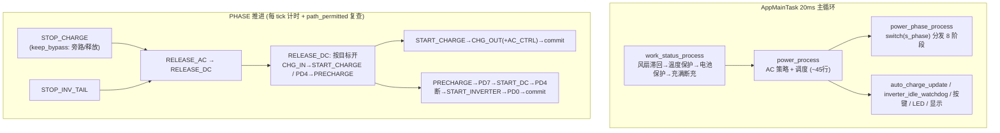

# SmartBattBox 应用层质量评审与重构执行（v2）

> 评审对象：
>
> `D:\Project_src_code\SmartPowerBoxProject\3.code\SmartBattBox`
> 平台：STM32F407VGT6 + FreeRTOS + CMSIS-RTOS v2 + STM32F4xx HAL
> 范围：`App/Src/app_main_task.c`（应用层核心，1090 行）+ `Core/Src/freertos.c`（优先级注释）
> 流程：**先输出方案评审（不改代码）→ 用户确认 P1+P2+P3 全做 → 分三轮执行，每轮 CubeIDE 编译 0 error/0 warning + git 提交**
> 前置：v1（`重构方案评审_v1.md`）已完成分层/解耦/存储迁移等重构；v2 聚焦状态机与代码组织质量。

---

## 一、评审结论（总览）

应用层**整体结构清晰**：主循环 8 步职责单一、通路状态机 PHASE 顺序推进、保护链顺序执行、通路合成逻辑唯一化（`resolve_target_path`）均已到位。

存在 3 类可优化点：① 状态机 2 个阶段语义重叠；② 电池有效性判定两处重复；③ `power_process` 单函数过长、AC 切换策略散布。本轮已全部按 P1/P2/P3 处理。

## 二、评审问题清单（发现 → 处理）

| # | 位置（重构前） | 问题 | 处理 |
|---|---|---|---|
| 1 | `path_phase_t` / `power_process` STOP_CHARGE 分支 | PHASE_STOP_CHARGE 与 PHASE_STOP_CHARGE_TAIL 语义重叠（仅提交目标不同） | **P1-① 合并**为单阶段 + `s_stop_chg_keep_bypass` 标志 |
| 2 | `path_permitted` :251-257 / `battery_protect` :913-916 | 电池"快照有效+方向故障位"判定两处重复 | **P1-② 提炼 `battery_path_ok()` 共用** |
| 3 | `power_process` :430-636 | 单函数 ~200 行，9 PHASE 分支 + 3 AC 策略混杂 | **P3 拆 `power_phase_process()`**，主函数收敛到 ~45 行 |
| 4 | `path_request` :318-345 | 充电组合切换特殊分支较重（AC_CTRL 开/关 + 直提 commit） | **P2-⑤ 提炼 `path_request_charge_switch()`** |
| 5 | `work_status_process` :993-995 | charge/invert 活跃判定（目标+继电器实测）内联重复 | **P2-⑥ 提炼 `path_active_charge()/path_active_invert()`** |
| 6 | `enter_fault` / `power_abort` | 故障时经 power_abort→path_commit 触发冗余 IDLE 状态日志 | **P1-④ enter_fault 内联复位**，只打一条 `ST x→6` |
| 7 | `freertos.c` :120,153 | 注释 AppMainTask(4) 与实际传参 6 不符 | **P1-③ 注释修正** |

## 三、不做事项（评审确认，无需改动）

| 项 | 依据 |
|---|---|
| 合并 `s_cur_path` / `s_target_path` | 停止过程中两者必然不同（target=新目标 / cur=已断），是 1.5s 尾段时序的状态依据 |
| 显示端共用 `path_charges` | 显示任务自维护 `s_path` 为分层解耦设计，跨层共用反耦合 |
| 删 `BATTERY_CORE_TEST` | 核心逻辑与 STM32 集成的编译隔离结构，删除会破坏 `tests/battery` |
| 改 `work_led_process` 相位算法 | 已简洁清晰，无冗余 |

## 四、执行记录

### 提交链

| 提交 | 内容 | 统计 |
|---|---|---|
| `aa9b748` | P1：阶段合并 + battery_path_ok + enter_fault 去双日志 + freertos 注释 | 2 files, +46/-24 |
| `68697c2` | P2：path_request_charge_switch + path_active_charge/invert | 1 file, +37/-16 |
| `31bc1a1` | P3：power_process 按 PHASE 拆分发 | 1 file, +107/-95 |

### 重构后状态机调度结构

## 五、语义等价性验证

- 各阶段计时常量、继电器动作顺序（充电 1.5s / 逆变三段 1.5s-0.5s-1.5s / 顺序断电 1.5s）与重构前逐行对应
- 特殊路径保留：CHARGE_BYPASS→BYPASS 保留 AC 直通、逆变中 AC 恢复转旁路、输入未知等待 5s 超时 abort
- 编译证据：三轮 `make -j4 all` 均 exit 0、无 warning（`text=63576` 稳定）
- 文件净行数 1090 持平（拆函数增加注释/空行），单函数复杂度 200 行 → 每 case 块 10-30 行

## 六、遗留项（非本轮范围）

| 项 | 状态 |
|---|---|
| `auto chg:` 诊断日志（`auto_charge_update`） | 保留至"接入 220V 不自动充电"复测闭环后删除 |
| `VP_ANIM_BATT_CFG` 动画参数地址（0x2032 仅做使能控制） | 等待屏端提供 ICL 起始索引/帧数配置 |
| 逆变直连温升实测（PATH_DC_FAST_MS=500） | 用户实测后可按需微调 |
| `.settings/language.settings.xml` | 环境哈希文件，永不提交 |
