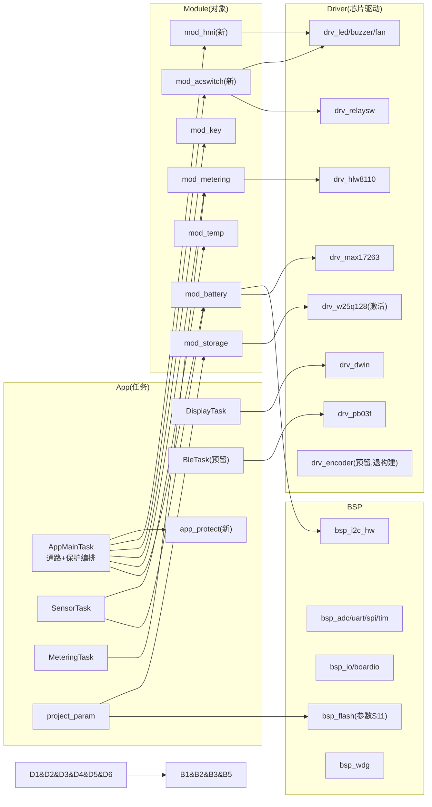

# SmartBattBox 重构：完整方案评审与逐文件执行清单（v1）

> 平台：STM32F407VGT6 + FreeRTOS + CMSIS-RTOS v2 + STM32F4xx HAL
> 状态：
>
> **规划阶段，未改动任何代码**
>
> 。本文为可执行蓝本，落地时按 "清理→去重→存储→解耦" 四步推进。
> 依赖规则：
>
> **上层只调用下层；每外设唯一任务持有，其他任务读快照 / 提交请求；App 不直连 Driver/BSP。**


***

## Part A. 方案评审（决策汇总）

### A1. 已锁定决策


| 域    | 条目                                              | 决策                                                |
| ---- | ----------------------------------------------- | ------------------------------------------------- |
| 死代码  | drv\_encoder / BLE 预留                           | 保留（预留），drv\_encoder 退构建                           |
| 死代码  | xMainQueueHandle                                | 保留，10→6 槽，AppMainTask 改读消息                        |
| 死代码  | app\_exti\_callback / mod\_storage\_log\_append | 删除                                                |
| 去重   | 模拟 I2C（bsp\_i2c.c）                              | 删除，仅留 bsp\_i2c\_hw                                |
| 存储   | 参数 / 电池记录                                       | 参数 primary 内部 S11；参数备份写外部 W25Q；电池学习记录回外部 W25Q     |
| 去重   | 同地址宏                                            | 保留 project\_param.h，删 bsp\_flash.h 重复             |
| 去重   | 双日志                                             | log\_print 直打 /logger\_out 受控（logger\_print 改名）   |
| 去重   | 告警位图                                            | 统一一套 sys\_alarm\_t（删 ALM\_\* 与 BAT\_FAULT\_\* 双套） |
| 去重   | 初始化入口                                           | 统一收敛 + 补 drv\_buzzer\_init                        |
| 去重   | main.h 重复 include                               | 移除                                                |
| 仓库   | Debug/Release/8112/AI 痕迹                        | 整理 + .gitignore                                   |
| 过度设计 | 消息队列框架                                          | 保留并启用                                             |
| 过度设计 | battery\_app\_\* API                            | 收敛为 mod\_battery.c 私有                             |
| 过度设计 | JSON 上报                                         | 保留，BleTask 消息触发                                   |
| 过度设计 | battery\_store\_t                               | **保持原契约**（外部 4KB 扇区，无需改造）                         |

### A2. 目标分层与模块 / 驱动归属




**每个硬件外设的唯一持有者**：


| 外设                     | 驱动                     | 持有任务 / 对象                       | 对外接口（快照 / 请求）                                       |
| ---------------------- | ---------------------- | ------------------------------- | --------------------------------------------------- |
| 电池 MAX17263 (I2C1)     | drv\_max17263          | SensorTask / mod\_battery       | mod\_battery\_\* / battery\_get\_snapshot           |
| 温度 NTC (ADC1)          | bsp\_adc               | SensorTask / mod\_temp          | mod\_temp\_get                                      |
| 计量 HLW8110×2 (UART2/3) | drv\_hlw8110           | MeteringTask / mod\_metering    | metering\_get\_info / mod\_metering\_get\_ac\_input |
| 继电器 / 接触器 (GPIO)       | drv\_relaysw           | AppMainTask / **mod\_acswitch** | mod\_acswitch\_select\_path/relay\_on/off           |
| 风扇                     | drv\_fan               | AppMainTask / **mod\_acswitch** | mod\_acswitch\_set\_fan                             |
| 告警 LED / 蜂鸣            | drv\_led / drv\_buzzer | AppMainTask / **mod\_hmi**      | mod\_hmi\_alarm / mod\_hmi\_buzz                    |
| 串口屏 (UART4)            | drv\_dwin              | DisplayTask                     | Send\_Msg\_AppDisplayTask（消息）                       |
| BLE(UART6)             | drv\_pb03f             | BleTask                         | 队列消息                                                |
| 按键 (GPIO)              | —                      | AppMainTask / mod\_key          | mod\_key 回调→主队列                                     |
| 内部 Flash               | bsp\_flash             | project\_param（参数 primary）      | bsp\_flash\_\*                                      |
| 外部 W25Q128 (SPI2)      | drv\_w25q128           | mod\_storage（参数备份 + 电池记录）       | mod\_storage\_\*                                    |


***

## Part B. 逐文件可执行重构清单

> 约定：★= 必改　●= 新增　◇= 删除　△= 可选。每文件给 "现状→改动→接口 / 函数映射"。


***

### B1. BSP 层

#### B1.1 ◇ `BSP/Src/bsp_i2c.c` + `BSP/Inc/bsp_i2c.h` — 删除


* 软件模拟 I2C，全工程无调用方。删除两个文件，并从构建源列表（sources.mk/subdir.mk）移除。

#### B1.2 ★ `BSP/Src/bsp_flash.c` + `BSP/Inc/bsp_flash.h` — 轻泛化 + 删重复常量


* **现状**：硬编码 `BSP_FLASH_PARAM_BASE/SIZE/SECTOR`（=0x080E0000/S11）；`init()/read(addr)/write(addr)/erase()`，`erase` 擦写死 S11。

* **改动**：


  * 删除 `BSP_FLASH_PARAM_BASE/SIZE/SECTOR` 三常量（唯一来源保留在 `project_param.h`）。

  * 接口改为由调用方传入参数区：


```
bool bsp\_flash\_init(uint32\_t base, uint32\_t size, uint32\_t sector); /\* 记录参数区 \*/

bool bsp\_flash\_read(uint32\_t addr, void \*buf, uint16\_t len);        /\* addr 校验基于记录的 base \*/

bool bsp\_flash\_write(uint32\_t addr, const void \*buf, uint16\_t len);

bool bsp\_flash\_erase(void);                                          /\* 擦记录的 sector \*/
```


* 内部静态保存 `base/size/sector`；`_addr_valid` 用保存值。

- **调用点**：`project_param.c` 的 `bsp_flash_init(PARAM_FLASH_BASE, PARAM_FLASH_SIZE, FLASH_SECTOR_11)`。注意：擦 S11 只清 primary（备份已移外部），安全。

- **依赖方向**：App→BSP 传参，无 BSP→App。

#### B1.3 ★ `BSP/Src/bsp_boardio.c` — 补 `drv_buzzer_init`


* 在 `bsp_boardio_init()` 末尾补 `drv_buzzer_init()`（现注释声明含蜂鸣器但漏调）。

#### B1.4 ★ `Core/Src/main.c` — 移除重复初始化


* 删 `main.c:173` 的 `drv_buzzer_init()`（已由 bsp\_boardio 统一初始化）。

#### B1.5 △ `BSP/Driver/drv_w25q128.{c,h}` — 恢复激活（无代码改动）


* 从 "退出构建" 改回**入构建**；承担参数备份 + 电池学习记录。`mod_storage` 的 `acquire()` 懒探测逻辑保留。


***

### B2. Module 层

#### B2.1 ★ `Module/Src/mod_storage.c` + `Inc/mod_storage.h` — W25Q 后端 + 参数备份接口 + 删桩


* **删**：`mod_storage_log_append()` 及其声明、`STORAGE_SEC_LOG_*`（日志区弃用）。

* **保留**：`mod_storage_init()`、`mod_storage_battery_read/program/erase`（W25Q 扇区 9/10，`STORAGE_SEC_BATTERY_START=9, COUNT=2`，互斥锁 + 懒探测）。

* **新增**（参数备份走扇区 0，`STORAGE_SEC_CONFIG`）：


```
/\* 通用字节读写，避免 Module→App 依赖 sys\_param\_t \*/

int mod\_storage\_param\_backup\_write(const uint8\_t \*buf, size\_t len); /\* 擦扇区0→program→readback \*/

int mod\_storage\_param\_backup\_read(uint8\_t \*buf, size\_t len);
```


* 复用现有 `acquire()/bounds()` 模式；扇区 0 常量沿用 `STORAGE_SEC_CONFIG 0u`。

#### B2.2 ★ `Module/Src/mod_battery.c` + `Inc/app_battery.h` + `Inc/mod_battery.h` — 收敛私有 + 告警映射


* **store 契约保持不变**：`battery_store_t` 绑定 `mod_storage_battery_*`，`sector_size=4096` 不动，双扇区轮换原样。

* **收敛私有**：`app_battery.h` 拆分为 `Module/Inc/mod_battery_internal.h`（含 `battery_app_t/battery_store_t/battery_policy_t/battery_app_*` 原型与 `BAT_FAULT_*`），仅 `mod_battery.c` include；对外 `mod_battery.h` 只留 `mod_battery_*` + 快照。

* **新增告警映射**：


```
uint32\_t battery\_alarm\_bits(void); /\* 把内部 BAT\_FAULT\_\* 折叠为 sys\_alarm\_t 位，供 AppMainTask 合并 \*/
```


* 命名上不再以 `app_` 前缀出现在 Module 层。

#### B2.3 ● `Module/Src/mod_acswitch.c` + `Inc/mod_acswitch.h` — 新增能量通路对象


* **归属**：AppMainTask 持有执行；私有 `drv_relaysw` + `drv_fan`。

* **从 app\_main\_task 迁入**：`energy_path_t` 枚举、`path_request/path_begin_stop/path_commit/path_permitted` 中的继电器互锁 + 先断后通 + 预充 / 释放等待时序、风扇开关。

* **接口**：


```
bool mod\_acswitch\_init(void);

bool mod\_acswitch\_select\_path(energy\_path\_t path);   /\* 强制"全断→死区≥50ms→吸合→回读" \*/

energy\_path\_t mod\_acswitch\_current\_path(void);

bool mod\_acswitch\_relay\_on(relay\_id\_enum id);

bool mod\_acswitch\_relay\_off(relay\_id\_enum id);

void mod\_acswitch\_set\_fan(fan\_id\_enum id, bool on);
```


* 边界：仅 AppMainTask 触碰；保护任务只读 `mod_acswitch_current_path()` 或提请求。

#### B2.4 ● `Module/Src/mod_hmi.c` + `Inc/mod_hmi.h` — 新增提示 / 指示薄对象


* **归属**：AppMainTask 持有；私有 `drv_led`(ALM) + `drv_buzzer`。

* **接口**：`mod_hmi_init()` / `mod_hmi_alarm(bool on)` / `mod_hmi_buzz(uint8_t times)`。

* 电池 12 灯仍由 SensorTask 经 mod\_battery 管理，不冲突。


***

### B3. App 层

#### B3.1 ★ `App/Inc/project_param.h` + `App/Src/project_param.c` — 参数备份移外部


* **现状**：primary @ S11 0x080E0000，backup @ S11+0x1000（同扇区）；`param_store` 擦整个 S11 双写。

* **改动**：


  * `project_param.h`：`PARAM_FLASH_BASE` 保留为唯一事实来源；新增 `PARAM_FLASH_SIZE`/`PARAM_FLASH_SECTOR`；**移除&#x20;**`PARAM_BACKUP_ADDR`（备份不再在内部）。

  * `project_param.c` include `mod_storage.h`；`_slot_valid(addr,…)` 拆为两个来源：


```
static bool \_primary\_valid(sys\_param\_t \*out); /\* 内部 bsp\_flash\_read(PARAM\_FLASH\_BASE) + CRC \*/

static bool \_backup\_valid(sys\_param\_t \*out);  /\* mod\_storage\_param\_backup\_read + CRC \*/
```


* `param_init()`：`bsp_flash_init(PARAM_FLASH_BASE,PARAM_FLASH_SIZE,FLASH_SECTOR_11)` → primary 读（内部）→ backup 读（外部，若 primary 坏则用并回写 primary）→ 默认值。

* `param_store()`：先写外部 backup（`mod_storage_param_backup_write`）→ 再擦 + 写内部 primary（`bsp_flash_erase` + `bsp_flash_write(PARAM_FLASH_BASE)`）。primary 最后提交保证最新。

- 依赖方向：project\_param→bsp\_flash（内部 primary）+ project\_param→mod\_storage（外部 backup）。

#### B3.2 ● `App/Inc/sys_alarm.h` + `App/Src/app_protect.c` + `Inc/app_protect.h` — 统一告警 + 保护对象


* **sys\_alarm.h**：定义 `sys_alarm_t` 位图（电池过压 / 欠压 / 过温 / 过流、逆变过温、充电过温、AC 输入异常、继电器故障、电池无效、外部存储故障、低 SoC …）。删除 app\_main\_task 的 `ALM_*` 与 app\_battery 对外 `BAT_FAULT_*`。

* **app\_protect**：


```
void app\_protect\_check(const TEMP\_INFO\_T\*, const BATT\_INFO\_T\*, const METER\_INFO\_T\*);

/\* 合并 alarm\_get() 输出 sys\_alarm\_t；触发关机/限功率/告警动作 \*/

uint32\_t alarm\_get(void);

void alarm\_merge(uint32\_t bits); /\* 单一合并入口 \*/
```


* 从 app\_main\_task 迁入保护阈值判定 + 告警合并。

#### B3.3 ★ `App/Src/app_main_task.c` + `Inc/app_main_task.h` — 拆保护、接消息、去驱动直连


* 移除直接 include：`drv_buzzer/drv_led/drv_fan/drv_relaysw` → 改 `mod_acswitch.h` / `mod_hmi.h` / `app_protect.h` / `sys_alarm.h`。

* 通路 / 风扇 / LED / 蜂鸣操作改走 `mod_acswitch_*` / `mod_hmi_*`。

* 删本地 `ALM_*` 与 `path_*` 互锁细节（迁 mod\_acswitch）；保留业务编排 + 关机时序 + 参数初始化。

* **接入主队列**：


```
for (;;) {

&#x20;   xQueueReceive(xMainQueueHandle, \&msg, pdMS\_TO\_TICKS(POLL\_MS));

&#x20;   switch (msg.MsgID) { case EVT\_KEY: ...; case EVT\_AC\_INPUT: ...; }

&#x20;   power\_process();   /\* 保持非阻塞状态机 \*/

}
```


* `app_main_task.h` 补充 `EVT_KEY/EVT_AC_INPUT/EVT_BATTERY_FAULT/EVT_BLE_CMD/EVT_DISP_ACK` 消息枚举。

#### B3.4 △ `Core/Src/freertos.c` — 主队列槽数 + 优先级注释一致化


* `MAIN_MSG_QUEUE_MAX_NUM` 10→6。

* 修正优先级注释与实际（现 Metering/Display/Main 均为 6）；明确 AppMainTask 语义优先级。

#### B3.5 ★ `App/Src/app_sensor_task.c` — 删 app\_exti\_callback


* 删空壳 `app_exti_callback()` 及 `stm32f4xx_it.c` 中对应调用点。

#### B3.6 △ `App/Src/app_metering_task.c` — 日志统一 + AC 事件


* `metering_verify_syscon()` 的 `log_print` → `log_info`。

* 可选：AC 输入状态变化时 `Send_Msg_AppMainTask(EVT_AC_INPUT)`。

#### B3.7 △ `App/Src/app_ble.c` — JSON 接线


* BleTask 消息循环增加 `EVT_BLE_REPORT` 处理 → 调用 `app_ble_report_status()`。

#### B3.8 ★ `App/Src/app_display_task.c` — 去重复 include


* 移除重复的 `#include "main.h"`。


***

### B4. Comm 层

#### B4.1 ★ `Comm/Inc/comm_logger.h` + `Comm/Src/comm_logger.c` — `logger_print`→`logger_out`


* 全局改名 `logger_print` → `logger_out`；`log_print` 宏指向 `logger_out(LOG_NONE,...)`。

* 全工程同步调用点（App/BSP/Module/Core 所有 `logger_print`）。


***

### B5. 构建 / 仓库


| 动作              | 内容                                                                                                            |
| --------------- | ------------------------------------------------------------------------------------------------------------- |
| 新增 `.gitignore` | `Debug/`、`Release/`、`*.o/*.d/*.elf/*.bin/*.map/*.hex/*.cyclo/*.su`、`.claude/`、`docs/superpowers/`、`tools/` 缓存 |
| 移除              | `Debug/`、`Release/` 陈旧构建；`Doc/8112_uart_code_rev5_001/`；AI 工具痕迹（审计 `_fix_if.py` 后定去留）                         |
| 构建列表            | `drv_w25q128` 重新入列；`drv_encoder`、`bsp_i2c` 移除                                                                 |
| 保留              | `.cproject/.project/.mxproject/.ioc/*.ld/*.sct`、`Doc/*.pdf`                                                   |


***

## Part C. 落地顺序、风险与验证

### C1. 落地顺序（四阶段，风险递增）


1. **清理（低）**：B1.1、B5、B3.5、B2.1 (删桩)、B3.8、B1.3/B1.4 (init 统一)

2. **去重（低 - 中）**：B4.1 (logger\_out)、B3.2 (sys\_alarm)、B1.2 (轻泛化)+B3.1 (参数双写)

3. **存储（中，烧录验证）**：B1.5 (w25q128 激活)+B2.1 (参数备份接口)+B3.1 (备份移外部)

4. **解耦（中 - 高，分批）**：B2.3 (mod\_acswitch)→B2.4 (mod\_hmi)→B3.2 (app\_protect)→B3.3 (拆分 + 接消息)

### C2. 风险与对策


| 风险                                 | 对策                                                   |
| ---------------------------------- | ---------------------------------------------------- |
| 参数 primary/backup 分属内外 Flash，回退链复杂 | 烧录验证 "内部 primary 损坏→读外部 backup→回写 primary"           |
| 开机外部 W25Q 访问时序                     | mod\_storage 懒探测；param\_init 在 AppMainTask 中调用时可安全访问 |
| 告警合并误伤既有日志 / 上位机                   | 保留日志原字段，仅内部语义统一；改动前备份基线                              |
| 拆分回归                               | 每步单独编译 + 烧录（模块自测→联调→全流程）                             |

### C3. 验证


* **存储**：电池记录 "写→读回→断电重启→加载最新"（外部双扇区轮换）；参数 "primary 损坏→backup 恢复"。

* **解耦**：grep 确认 App 不再 include `drv_*`/`bsp_io`/`bsp_adc`；编译告警清零。

* **回归**：Debug/Release 各跑 上电→BYPASS/CHARGE/INVERT→关机保存，日志基线比对。


***

## 附：改动文件总表


| 文件                                                              | 动作                          |
| --------------------------------------------------------------- | --------------------------- |
| BSP/Src/bsp\_i2c.c、Inc/bsp\_i2c.h                               | ◇ 删除                        |
| BSP/Src/bsp\_flash.c、Inc/bsp\_flash.h                           | ★ 轻泛化 + 删重复常量               |
| BSP/Src/bsp\_boardio.c                                          | ★ 补 drv\_buzzer\_init       |
| Core/Src/main.c                                                 | ★ 移除重复 drv\_buzzer\_init    |
| Core/Src/freertos.c                                             | △ 主队列 6 槽 + 优先级注释           |
| BSP/Driver/drv\_w25q128.\*                                      | △ 重新激活                      |
| Module/Src/mod\_storage.c、Inc/mod\_storage.h                    | ★ 参数备份接口 + 删 log\_append    |
| Module/Src/mod\_battery.c、Inc/app\_battery.h、Inc/mod\_battery.h | ★ 收敛私有 + 告警映射               |
| Module/Src/mod\_acswitch.\*                                     | ● 新增                        |
| Module/Src/mod\_hmi.\*                                          | ● 新增                        |
| App/Inc/project\_param.h、Src/project\_param.c                   | ★ 备份移外部                     |
| App/Inc/sys\_alarm.h                                            | ● 新增                        |
| App/Src/app\_protect.c、Inc/app\_protect.h                       | ● 新增                        |
| App/Src/app\_main\_task.c、Inc/app\_main\_task.h                 | ★ 拆分 + 接消息 + 去驱动直连          |
| App/Src/app\_sensor\_task.c                                     | ★ 删 app\_exti\_callback     |
| App/Src/app\_metering\_task.c                                   | △ log→info / AC 事件          |
| App/Src/app\_ble.c                                              | △ JSON 接线                   |
| App/Src/app\_display\_task.c                                    | ★ 去重复 include               |
| Comm/Inc/comm\_logger.h、Src/comm\_logger.c                      | ★ logger\_print→logger\_out |
| 顶层                                                              | ★ .gitignore + 清理           |

---

## Part D. NTC 温度采集与多路 ADC DMA 检测（补充）

### D1. NTC 10K 温度计算验证 —— 公式与参数正确

接法假定：3V3A → 上拉 10K → Vout → NTC(10K) → GND（NTC 在低端）。

推导：raw = R_ntc/(R_pullup+R_ntc) × RES → R_ntc = R_pullup×raw/(RES−raw)；B 值方程 T=1/(1/T0+ln(R/R0)/B)−273.15。

三点交叉验证（R_pullup=10K, R0=10K, T0=298.15K, B=3950, RES=4095, VREF=3V3）：

| 温度 | 理论 R(Ω) | 理论 raw | 公式反推 R(Ω) | 反推温度 | 结论 |
|---|---|---|---|---|---|
| 25°C | 10000 | 2048 | 10004 | 25.0°C | ✅ |
| 0°C | 33630 | 3156 | 33610 | 0.0°C | ✅ |
| 60°C | 2485 | 815 | 2485 | 60.0°C | ✅ |

- 公式与参数均正确；采样时间 480 cycles 对 10K//10K≈5K 源阻抗足够。
- **硬件依赖点**：公式假定 NTC 在低端。若原理图实际 NTC 在高端（上拉到 NTC），公式需改为 `R_ntc = R_pullup×(RES−raw)/raw`，需按原理图确认后定。
- 边界：raw==0 或 raw>=RES → 返回 -1000（开路/短路异常），合理。

### D2. 多路 ADC DMA 检测结论 —— 当前配置不正确

`bsp_adc.c` 三处矛盾：

| # | 证据 | 问题 |
|---|---|---|
| 1 | `ContinuousConvMode=ENABLE` + `DMAContinuousRequests=ENABLE` + `DMA_Mode=DMA_NORMAL` | 冲突：ADC 连续转 + DMA 连续请求，DMA 却是 NORMAL，搬完 5 个即停，后续结果无人搬，行为不确定 |
| 2 | 头文件宣称"DMA2_Stream0 循环、5 通道×32 块交织、19-3 多样本平均"，实际 buf 长度=5、`get_raw_average` 直接返回单样本 | 设计与实现严重不符，多样本平均未实现 |
| 3 | `mod_temp_update` 每轮读后手动 `bsp_adc_dma_enable` 重启 | 与连续模式相悖；首轮 DMA 未完成时读到全 0 → 温度误判 -1000 |

**修复方案（二选一）**：
- **方案 A（推荐，与头文件宣称一致）**：`DMA_Mode=DMA_CIRCULAR` + 连续转换 + DMA 连续请求。DMA 环形持续刷新 s_adc1_dma_buf，任意时刻读即最新；多样本平均读环形窗口 N 个值平均。改动：`bsp_adc_init` 中 DMA Mode→CIRCULAR；`bsp_adc_dma_enable` 只在 init 启动一次；新增 `bsp_adc_get_raw_average` 对环形缓冲取 N 均值。
- **方案 B（干净单次扫描）**：`ContinuousConvMode=DISABLE` + `DMAContinuousRequests=DISABLE` + NORMAL。每次 `bsp_adc_dma_enable` 启动一次 5 通道扫描，DMA TC 中断后再启动。改动：改上述两处 Init 字段；`mod_temp_update` 保持"读旧值→重启"。

推荐方案 A：消除手动重启与时序隐患，符合注释/头文件设计意图，可真正实现多样本平均。

### D3. 落地
- `BSP/Src/bsp_adc.c`：按方案 A 或 B 修正 DMA/连续配置；补齐多样本平均；统一头文件注释与实现。
- `Module/Src/mod_temp.c`：`_raw_to_temp` 保留（已验证正确）；按硬件接法确认 NTC 分压方向。
- 验证：三路 NTC 室温读数对照万用表/已知温度；异常开路/短路通道返回 -1000；断/接外电复测。

---

---

## Part E. 整改计划与执行步骤

### E1. 阶段总览

| 阶段 | 风险 | 依赖 | 里程碑 | 验收 |
|---|---|---|---|---|
| 1 清理与仓库治理 | 低 | 无 | M1 | 编译通过 + 关键路径回归 |
| 2 去重与统一 | 低-中 | 阶段1 | M2 | 编译 + 告警/日志基线 |
| 3 存储迁移 | 中 | 阶段2(日志/告警) | M3 | 烧录 + 回退链/重启加载 |
| 4 解耦重构 | 中-高 | 阶段2(sys_alarm) | M4 | 全流程回归 + grep 解耦检查 |

阶段 3 与阶段 4 相互独立，可部分并行（存储与解耦分属不同模块）。

### E2. 阶段 1：清理与仓库治理（无功能改动，随时可编译验证）

| 步骤 | 动作 | 验证/回滚 |
|---|---|---|
| S1.1 | 新增 `.gitignore`（Debug/、Release/、*.o/*.d/*.elf/*.bin/*.map/*.hex、.claude/、docs/superpowers/、tools/ 缓存） | git status 不再显示构建产物 |
| S1.2 | 移除 Debug/、Release/ 陈旧构建 | IDE/CI 可重建；先确认无人引用产物 |
| S1.3 | 移除 Doc/8112_uart_code_rev5_001/ | Doc 仅剩本项目文档 |
| S1.4 | 审计归档 .claude/、docs/superpowers/、tools/、_fix_if.py | 业务目录干净；_fix_if.py 定去留 |
| S1.5 | 删 app_exti_callback + stm32f4xx_it.c 调用点 | 编译通过 |
| S1.6 | 删 mod_storage_log_append 及其声明 | 编译通过 |
| S1.7 | 移除 app_display_task.c 重复 main.h | 编译通过 |
| S1.8 | init 统一：bsp_boardio 补 drv_buzzer_init；main.c 删重复 | 上电验证初始化顺序/蜂鸣 |
| S1.9 | 构建列表移除 bsp_i2c.c、drv_encoder.c | 编译通过 |

**里程碑 M1**：编译通过，上电关键路径回归通过。

### E3. 阶段 2：去重与统一

| 步骤 | 动作 | 验证/回滚 |
|---|---|---|
| S2.1 | 删除 bsp_i2c.c/h 源文件 | 编译通过 |
| S2.2 | comm_logger：logger_print→logger_out 全工程改名 | 编译 + 日志正常输出 |
| S2.3 | app_metering_task.c 的 log_print→log_info | 编译通过 |
| S2.4 | 新建 sys_alarm.h；app_main_task 删 ALM_*；app_battery 收敛 BAT_FAULT_*；mod_battery 加 battery_alarm_bits() | 编译 + 上位机告警解析比对基线 |

**里程碑 M2**：编译通过，告警/日志输出与改动前基线一致。

### E4. 阶段 3：存储迁移（需烧录验证）

| 步骤 | 动作 | 验证/回滚 |
|---|---|---|
| S3.1 | drv_w25q128 重新入构建 | 编译通过 |
| S3.2 | bsp_flash 轻泛化 init(base,size,sector) + 删重复常量 | 编译通过 |
| S3.3 | mod_storage 新增 mod_storage_param_backup_write/read(扇区0)；删日志区常量 | 编译通过 |
| S3.4 | project_param：删 PARAM_BACKUP_ADDR；拆 _primary_valid/_backup_valid；param_store 双写 | 编译通过 |
| S3.5 | 烧录验证：参数 primary/backup 回退链 + 电池记录写→读回→重启加载 | 现场测试 |

**里程碑 M3**：参数双区回退链 + 电池记录断电保持均验证通过。

### E5. 阶段 4：解耦重构（分批，每步单独编译+烧录）

| 步骤 | 动作 | 验证/回滚 |
|---|---|---|
| S4.1 | 新增 mod_acswitch：迁入 energy_path_t + 互锁时序 + fan | 通路切换 BYPASS/CHARGE/INVERT 验证 |
| S4.2 | 新增 mod_hmi：alarm/buzz | 告警 LED/蜂鸣验证 |
| S4.3 | 新增 app_protect + sys_alarm 合并 | 保护触发（过温/过压）验证 |
| S4.4 | app_main_task 拆分：去 4 驱动直连；接 xMainQueueHandle(6槽) + EVT_* 消息路由 | 全流程回归 |

**里程碑 M4**：App 层不再 include drv_*/bsp_io/bsp_adc（grep 核验），全流程回归通过。

### E6. 执行纪律（每步通用）

* 每步改动前 `git add` 存档当前可用版本；失败即还原该步。
* 每步完成后 `Compile` + 最小验证（编译告警清零）；烧录级步骤才上机。
* 阶段 3 与阶段 4 可并行推进（不同模块/文件交集小），但提交/回归分别独立。
* 所有步骤完成后：grep 解耦核验 + 全流程回归 + 存储链路测试 + 日志基线比对。

### E7. 完成标准

| 检查项 | 达标 |
|---|---|
| 编译 | 0 告警 |
| 解耦 | grep App 层无 drv_*/bsp_io/bsp_adc 直接引用 |
| 存储 | 参数双区回退 + 电池记录断电保持通过 |
| 回归 | 上电→BYPASS/CHARGE/INVERT→关机保存 全链路通过 |
| 仓库 | 无陈旧构建/旧工程/AI 痕迹 |
---